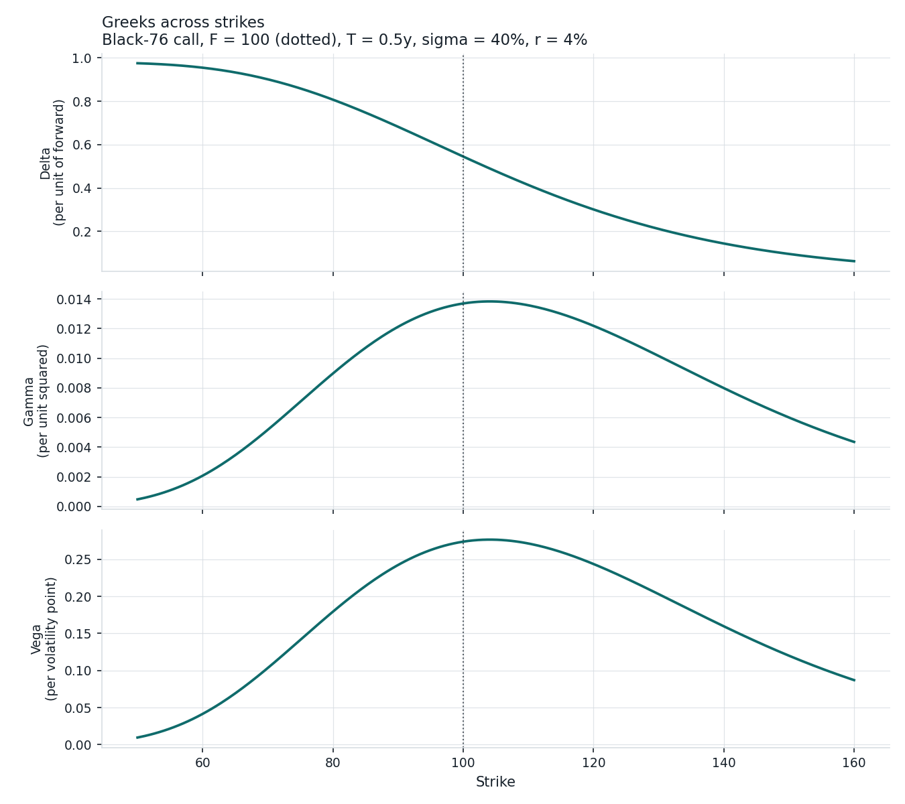
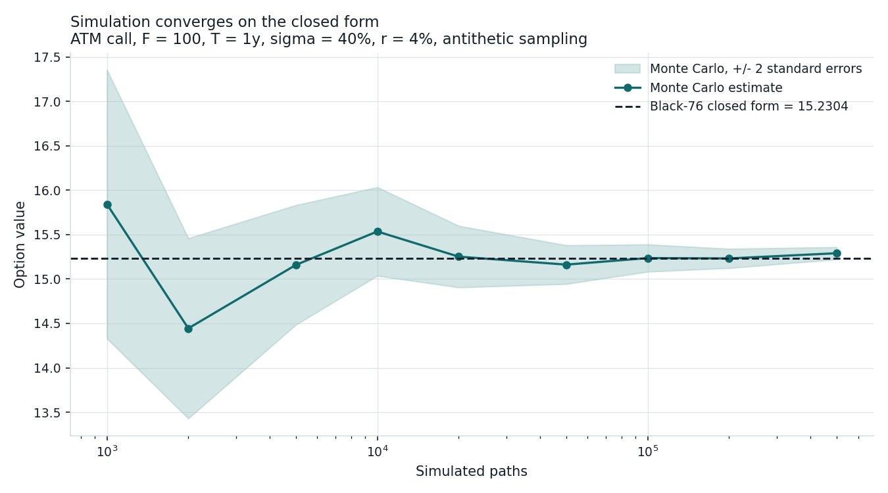
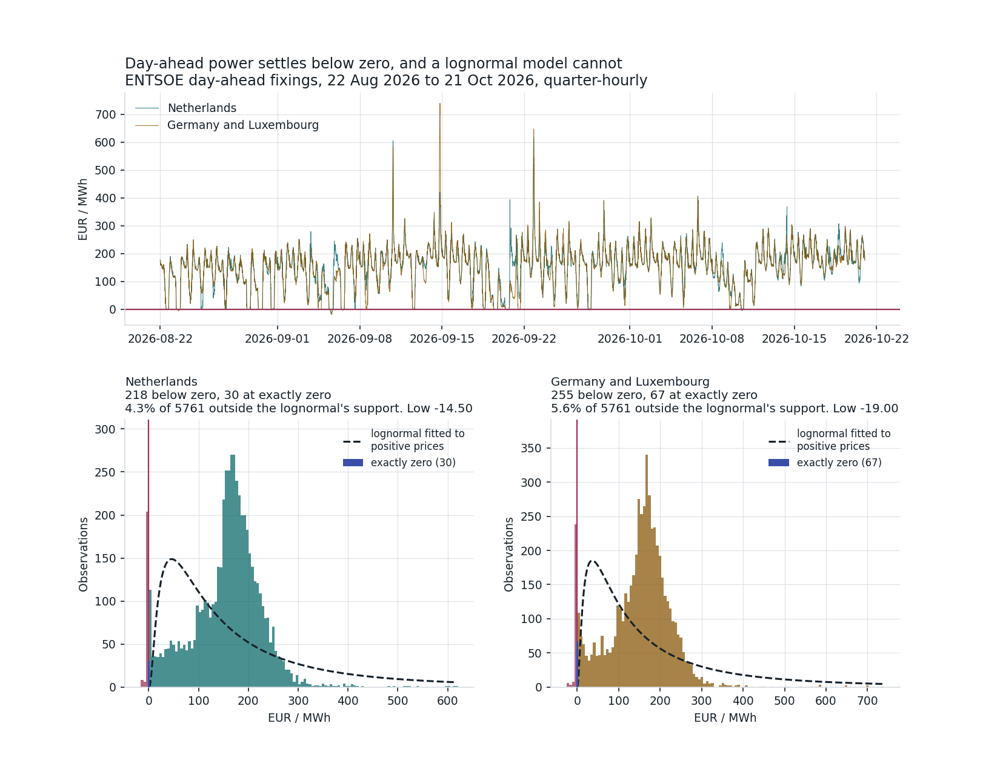

# energy-derivatives-pricing

Pricing library for energy and commodity derivatives: Black-76 for options on
forwards and futures, Black-Scholes-Merton for spot-based contracts, full
analytic Greeks, implied volatility, and Monte Carlo simulation.

[](https://github.com/Amitav507/energy-derivatives-pricing/actions/workflows/ci.yml)

The closed-form pricing core has no dependencies beyond the standard library.
Simulation uses numpy. The optional market data layer pulls real forward
curves and rate curves from free public sources.

## Install

```bash
pip install -e ".[dev]"
```

## Quickstart

```python
from engine import Black76, OptionType

# A three month call on a gas forward at 3.40, struck at 3.50, 45% vol.
option = Black76(
    forward=3.40,
    strike=3.50,
    time_to_expiry=0.25,
    rate=0.04,
    volatility=0.45,
    option_type=OptionType.CALL,
)

print(option.price())          # 0.259
print(option.greeks().delta)   # 0.489

# Recover the volatility the market is quoting.
print(option.implied_volatility(market_price=0.30))
```

Greeks come back in raw units. Divide vega by 100 for a one volatility point
move, theta by 365 for a day of decay, and rho by 100 for a 1% rate move.



Three things in that figure are worth more than the shapes themselves.

**Delta tops out at the discount factor, not at 1.** Under Black-76 delta is
`e^(-rT)·N(d1)`, so even a call certain to be exercised shows 0.98 here
rather than 1.00. The payoff arrives at expiry, not today.

**Delta at the forward is 0.545, not 0.50.** The rule of thumb that an
at-the-money option has a delta of a half is off by four and a half points at
these parameters, because `d1 = ½σ√T` is strictly positive. The gap widens
with volatility and maturity, so it is largest exactly where energy options
live.

**Gamma and vega peak above the forward, and at the same strike.** Both carry
`φ(d1)`, maximised when `d1 = 0`, which is `K = F·exp(½σ²T)` = 104.1 here
rather than 100. That strike is the delta-neutral straddle, which is why
volatility surfaces quoted by delta use it as the at-the-money convention
instead of `K = F`.

Vega reads 0.276 per volatility point against an option worth 11.02, so a
single point of volatility is about 2.5% of the option's value. That ratio is
why a scalar sigma is the weakest assumption in this library.

## Why Black-76 rather than Black-Scholes

Energy and commodity options are written on forwards and futures, not on
spot. Black-Scholes-Merton prices spot plus a cost of carry, which for a
commodity means financing, storage and convenience yield. Convenience yield
is unobservable and moves exactly when it matters, and for power the whole
framework collapses, because power cannot be stored and no spot-forward
arbitrage exists to define a carry at all.

Black-76 sidesteps this by pricing off the forward the exchange already
quotes. That quote has priced the carry for you, so it never has to be
estimated. Formally it is the zero carry case of Black-Scholes-Merton, and
both are implemented here.

One consequence the library gets right and a naive substitution does not.
Under Black-76 the rate enters only through the discount factor, never
through `d1` or `d2`, so rho is `-T * price` and is always negative. Pricing
Black-76 by setting `dividend_yield = rate` in a Black-Scholes engine
reproduces the price and four of the Greeks exactly, but reports rho with the
wrong sign, because it differentiates the rate while holding the dividend
yield fixed. `Black76` is a real implementation rather than that
substitution, and `tests/test_black76.py` pins the difference.

## Validation

Correctness is checked three independent ways rather than against the
library's own formulas.

**Against a reference implementation.** Prices agree with `py_vollib` to
**2.5e-14** across a 144 point grid of forward, strike, maturity and
volatility. At the prices in that grid one floating point unit is about
1.4e-14, so the residual is under two units and comes from the normal CDF
itself: `py_vollib` goes through `scipy.stats.norm.cdf`, this library uses
`math.erf`.

**Against simulation.** Monte Carlo and the closed form are independent
numerical routes to the same number. `tests/test_monte_carlo.py` asserts they
agree within four standard errors, which is a statistical test rather than an
arbitrary tolerance.



The shaded band is two standard errors, so it should contain the true value
about 95% of the time, and it contains the closed form at every path count
drawn. That is the test passing, as a picture.

Two details matter more than the convergence itself. The estimate scatters to
both sides of the line rather than creeping up from below, which is what an
unbiased estimator looks like. And the band narrows as `1/sqrt(N)`, so the
five hundredfold rise in paths across this chart buys only about a twentyfold
reduction in error. That cost structure is why simulation is expensive when
you want precision and cheap when you want structure, and it is the reason
closed forms are still worth having.

At a thousand paths the estimate is unusable: the band spans roughly three
points on an option worth 15.23, a fifth of its value. This is why the test
asserts agreement in standard errors rather than against a fixed tolerance,
which would be meaningless without stating the path count alongside it.

Both figures regenerate from `scripts/make_figures.py` and use no live market
data, so they stay correct.

**Against no-arbitrage identities.** Put-call parity in both the spot and
futures forms, no-arbitrage price bounds, Greek sign and bound conditions,
and textbook reference values.

Two real pricing bugs were found and fixed this way, both documented in the
tests: a zero-volatility branch that returned undiscounted spot intrinsic
instead of the discounted payoff on the forward, and an implied volatility
solver whose lower bound rejected valid deep in-the-money European put quotes,
which legitimately trade below `K - S` because they cannot be exercised early.

## Monte Carlo

```python
from engine import price_european, OptionType

result = price_european(
    forward=3.40, strike=3.50, time_to_expiry=0.25,
    rate=0.04, volatility=0.45,
    option_type=OptionType.CALL,
    paths=200_000, seed=42,
)
print(result)   # price +/- standard error, with a 95% confidence interval
```

Antithetic sampling is on by default. Because antithetic draws are not
independent, the standard error is computed from the pair averages rather
than from all payoffs, which the naive calculation would overstate.

Simulation exists here to cross-check the closed forms, and as the route to
contracts that have no closed form: path dependent payoffs, average price
options, and the volume optionality inside a flexible supply contract.

## Market data

The optional data layer assembles pricing inputs from free public sources.

```bash
pip install -e ".[data]"
python notebooks/multi_asset_demo.py
```

| Module | Source | Status |
|---|---|---|
| `marketdata.futures_prices` | Yahoo Finance continuous futures: gas, crude, metals | run against the live API |
| `marketdata.rates` | FRED, SOFR and Treasury constant maturity | run against the live API |
| `marketdata.realized_vol` | Rolling annualised volatility from log returns | exercised by the demo |
| `marketdata.entsoe_power` | EU day-ahead power prices, ENTSOE | run against the live API |

`entsoe_power` needs a free ENTSOE Transparency Platform key, which the demo
does not require. Two things it is worth knowing before using it. **Great
Britain is not available, and has no clean free substitute**: since Brexit GB
sits outside the EU internal energy market and a GB query returns
`NoMatchingDataError` rather than an empty series. There is no direct public
free API for GB historical day-ahead prices elsewhere either. Elexon publishes
Market Index Data, but that is an index rather than the day-ahead price series
itself. And European day-ahead now clears on **quarter-hourly** market
time units, roughly 96 points a day rather than 24, which has to be carried
through any annualisation or the answer is out by a factor of two.

Rates are converted to continuous compounding before use. Treasury constant
maturity yields are quoted bond-equivalent and SOFR is simple annualised. At
5% rate levels, feeding those in raw costs about 6 basis points on the
Treasury points and about 12 on SOFR.

## Power, and where this library stops working

Everything above assumes prices are lognormal, which is the assumption that
makes `ln(F/K)` meaningful and guarantees the underlying stays positive. On
European power that assumption is simply false, and not as a tail curiosity.

The markets below are Dutch and German rather than British, because GB is not
obtainable from free sources at all, for the reasons in the data note above.



Rose bars are settlements below zero and the blue bar is settlements at
exactly zero, both driven by inflexible generation meeting low demand in high
renewable output hours. Together they are 4.3% of Dutch and 5.6% of German
quarter-hours across this window. The dashed curve is a lognormal fitted to
the positive observations, and it assigns probability **zero** to every one
of them, because its support is the strictly positive line. No recalibration
fixes that, since the support is wrong rather than the parameters.

The model also fails where it is allowed to work. That dashed curve peaks
near 45 EUR while the observed distribution peaks near 165, and the data
carries a long low shoulder that a single lognormal cannot reproduce. So the
fit is poor across the positive region too, which matters more than it might
look: it means a lognormal misprices ordinary power hours, not just the
exceptional ones.

The standard answer to the first failure is a Bachelier model, where the
forward diffuses arithmetically (`dF = σ dW`) rather than geometrically and
admits negative prices naturally. That is the next model to add here, and
this figure is why it comes before the volatility surface.

The second failure needs something else, because Bachelier is also unimodal.
The shape here is the merit order showing through: hours where renewables
cover most of demand clear low on the supply stack, hours set by gas cluster
near its marginal cost, and scarcity hours spike. Reproducing that calls for
mean reversion with regime switching or jumps, or a structural model of the
stack itself, rather than any single diffusion.

One honest qualification on all of this. These are **spot** prices, and
options are written on forwards covering a delivery period, which average
over exactly the hour-to-hour variation producing this shape. A lognormal
fits a monthly baseload forward considerably better than it fits this
histogram. The support problem survives that averaging, since a forward over
a period whose expected average is negative is itself negative, and shaped
products concentrated in solar hours get there readily. The shape problem
largely does not survive it. So of the two failures, the one that actually
governs option pricing here is the first, which is the one Bachelier fixes.

Worth being clear about what this figure is and is not. It is day-ahead
**spot**, which is what free data gives you. Options are written on
**forwards**, which sit behind ICE, EEX and vendor terminals. So this
motivates the model choice rather than demonstrating a priced power option.

Regenerate with `python scripts/make_power_figure.py`, which needs an ENTSOE
key in `ENTSOE_API_KEY`. The counts and the date live in the figure itself,
so they stay accurate to when it was drawn.

## Project layout

```
engine/
  black76.py        Options on forwards and futures
  black_scholes.py  Spot-based, with continuous dividend yield
  monte_carlo.py    Simulation, antithetic sampling, standard errors
  _solver.py        Bracketed Newton implied volatility, shared
  cli.py            Command line pricer
marketdata/         Forward curves, rate curves, realized volatility
tests/              Pricing tests, run in CI
notebooks/          End to end demo across several underlyings
```

## Known limitations

Stated plainly, because they are the difference between a pricing library and
a pricing system.

- **Volatility is a scalar.** One number per underlying, so there is no
  smile, no skew and no term structure. Real commodity surfaces have all
  three, including the Samuelson effect and hard seasonality in gas and
  power. A strike and tenor indexed surface is the main piece of work
  outstanding.
- **Volatility comes from realized, not implied.** Realized volatility is
  backward looking and contains no variance risk premium, so it sits
  systematically below implied. Calibrating to a quoted surface needs vendor
  data that is not freely available.
- **Lognormal only.** Power prices go negative and WTI settled negative in
  April 2020. A lognormal model cannot represent that at all, as the power
  section above shows against live data. A Bachelier model is the standard
  answer and is the next thing to implement.
- **European exercise only.** NYMEX crude options are American style.
- **Vanilla payoffs only.** No Asian options, which dominate oil products,
  and no spread options, which is how spark and dark spreads are priced.
- **Forward curve is a single point.** The front month close stands in for
  the whole curve, discarding contango, backwardation and seasonal shape.
- **Continuous futures contracts.** Yahoo `=F` series splice successive
  contracts without back-adjusting, so roll dates can inject volatility that
  is not a real market move. Checked on the current sample and roll artifacts
  were not driving the estimate, but the exposure is real.
- **The market data layer is not covered by CI**, because it calls live
  external APIs. Only the pricing tests run there.

## Licence

MIT.
